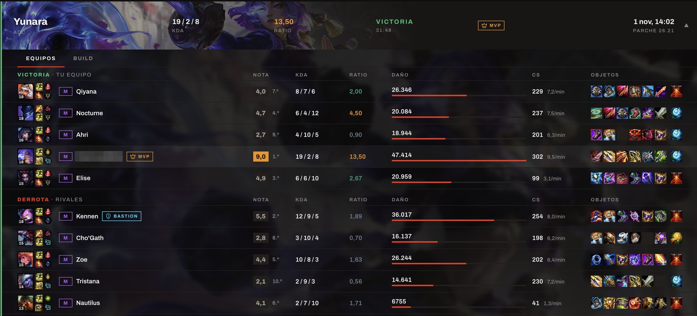

# project0

Herramienta personal de estadísticas de League of Legends. Guarda las
partidas de ranked solo/duo de los invocadores seguidos con la API de Riot y
las enseña en una página con el rango, la evolución de LP, los campeones más
jugados y el detalle de cada partida.

Es un proyecto para aprender DevOps con una aplicación real, de punta a
punta: contenedores con Docker y Compose, CI con GitHub Actions, despliegue
en Kubernetes con Helm y monitorización con Prometheus y Grafana.


## Qué hace

- **Collector** — cada hora pide a Riot las partidas nuevas, con su detalle,
  su timeline y el rango de los diez jugadores, y las guarda en PostgreSQL.
  Solo pide lo que le falta.
- **API** — FastAPI sobre lo guardado, con caché en Redis. No llama nunca a
  Riot, así que consultar las estadísticas no gasta peticiones.
- **Página** — JavaScript sin librerías, servido por nginx. Perfil con el
  rango, el resumen de la temporada, los campeones más jugados, el historial
  con filtros y el detalle de cada partida, con una nota propia para cada
  jugador y los sellos MVP y BASTION. Un botón lanza el collector en el
  momento, sin esperar a su hora.
- **Tests y CI** — pytest contra un PostgreSQL y un Redis propios. GitHub
  Actions pasa Ruff, los tests y `helm lint`, construye las tres imágenes y,
  en `main`, las sube a GitHub Container Registry.
- **Kubernetes** — todo corre en un clúster local con kind, instalado con un
  chart de Helm propio. Las migraciones van en un hook, PostgreSQL en un
  StatefulSet con un disco que se conserva, el collector en un CronJob y la
  entrada por Traefik con Gateway API. Para el botón de actualizar, la API
  crea Jobs con una ServiceAccount de permisos mínimos, y una política de
  admisión solo le deja crear copias del collector.
- **Monitorización** — Prometheus lee las métricas del clúster y las de la
  API, que cuenta sus peticiones y cuánto tarda en cada ruta. Grafana tiene
  un dashboard de la API, y hay alertas para cuando el collector deja de
  funcionar o la API da errores, que llegan a un canal de Discord.

## Capturas

El detalle de una partida tiene dos pestañas. Equipos enseña a los diez
jugadores con su nota, y Build el orden de compra, las runas y las
habilidades del jugador elegido.




## Arquitectura

En el clúster, un CronJob lanza el collector cada hora. Pide a Riot las
partidas nuevas y las guarda en PostgreSQL:

```
CronJob collector  ──cada hora──▶  pod collector  ──▶  API de Riot
                                        │              partidas, timeline
                                        │              y rangos
                                        └──▶  PostgreSQL
```

Cuando alguien abre la página, todo entra por Traefik. Manda `/api/` a la
API, quitándole el prefijo, y lo demás al frontend:

```
navegador ──▶ Traefik :80 ──┬── /        ──▶ frontend   la página (nginx)
                            │
                            └── /api/…   ──▶ api        sin el /api
                                              ├──▶ Redis        ¿está cacheada?
                                              └──▶ PostgreSQL   solo si no lo está
```

Cada despliegue es un `helm upgrade`. Helm aplica primero las migraciones con
un Job, y cuando acaban sustituye los pods de la API y del frontend de uno en
uno:

```
helm upgrade ──▶ Job migrations (Flyway) ──termina──▶ api y frontend, de uno en uno
```

La página pide los datos con rutas relativas, como `/api/matches`, así que
comparte origen con la API y no necesita CORS.

Compose es el entorno de desarrollo. Levanta los mismos servicios en la
máquina, con la página en `http://localhost:8080`. Ahí el reverse proxy es el
nginx del frontend, con las mismas reglas que Traefik, y Flyway aplica las
migraciones antes de que arranquen el collector y la API:

```
db ──sano──▶ flyway ──termina──▶ collector / api
```

## Stack

| Parte | Herramientas |
|---|---|
| Collector y API | Python 3.14, requests, FastAPI, uvicorn, psycopg |
| Datos | PostgreSQL 16, Flyway, Redis 8 |
| Página | HTML, CSS y JavaScript sin librerías, nginx |
| Contenedores | Docker, Docker Compose |
| CI | GitHub Actions, Ruff, pytest, `helm lint`, GitHub Container Registry |
| Kubernetes | kind, Helm 4, Traefik con Gateway API |
| Monitorización | Prometheus, Grafana y Alertmanager con kube-prometheus-stack |

## Arrancarlo

Hacen falta Docker y una clave de la API de Riot, que se pide en
https://developer.riotgames.com. Para el clúster, además, kind, kubectl y
Helm 4.

Con Compose, primero se crea el `.env` a partir del ejemplo y se rellenan
sus valores:

```bash
cp .env.example .env
```

Después se levanta todo:

```bash
docker compose up
```

La página queda en `http://localhost:8080` y la API en
`http://localhost:8000`. Las variables del `.env` y el resto de comandos
están en [docs/desarrollo.md](docs/desarrollo.md).

En el clúster la página queda en `http://localhost`, y Grafana, Prometheus y
Alertmanager en `http://grafana.localhost`, `http://prometheus.localhost` y
`http://alertmanager.localhost`. La instalación desde cero está en
[docs/kubernetes.md](docs/kubernetes.md#instalar-desde-cero).

## Documentación

| Fichero | Qué cuenta |
|---|---|
| [desarrollo.md](docs/desarrollo.md) | Requisitos, configuración, Compose y logs |
| [collector.md](docs/collector.md) | Qué pide a Riot y cómo lo guarda |
| [base-de-datos.md](docs/base-de-datos.md) | Las tablas, la nota y los sellos, las migraciones y los backups |
| [api.md](docs/api.md) | Los endpoints, la caché y la ETag |
| [frontend.md](docs/frontend.md) | La página, nginx, Data Dragon y la CSP |
| [tests-y-ci.md](docs/tests-y-ci.md) | Los tests y el pipeline |
| [kubernetes.md](docs/kubernetes.md) | Instalar, desplegar, volver atrás y cada pieza en el clúster |
| [monitorizacion.md](docs/monitorizacion.md) | Prometheus, Grafana y Alertmanager, las métricas de la API, el dashboard y las alertas |

## Estructura

```
collector.py              baja las partidas de Riot y las guarda
api.py                    sirve lo guardado por HTTP
api_cache.py              la caché de la API, que también vacía el collector
refresh.py                lanza el collector desde la API, con la API de Kubernetes
config.py                 la configuración común
test_*.py, conftest.py    los tests
migrations/               el esquema, versionado con Flyway
frontend/                 la página y su configuración de nginx
charts/project0/          el chart de Helm de la aplicación, con el dashboard de Grafana
platform/                 lo que va fuera del chart: namespaces, StorageClass, Gateway, Traefik y Prometheus
.github/workflows/        el pipeline de GitHub Actions
docker-compose.yml        el entorno de desarrollo
docker-compose.test.yml   la base y el Redis de los tests
kind-config.yaml          el clúster local
docs/                     la documentación
MEJORAS.md                lo que falta y la deuda técnica
```

El código, las tablas y las rutas están en inglés. Los comentarios, los
mensajes de consola y la documentación, en español.

## Qué falta

Lo que falta y la deuda técnica están en [MEJORAS.md](MEJORAS.md).

## Aviso legal

project0 isn't endorsed by Riot Games and doesn't reflect the views or
opinions of Riot Games or anyone officially involved in producing or managing
Riot Games properties. Riot Games, and all associated properties are
trademarks or registered trademarks of Riot Games, Inc.
