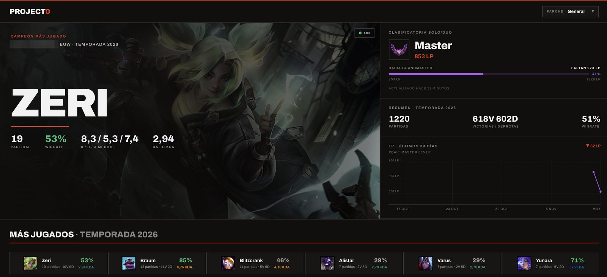
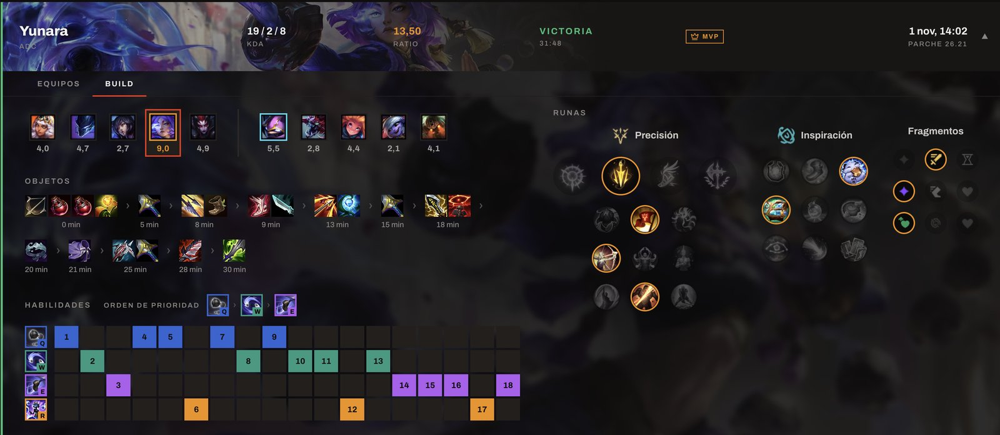

# project0

English | [Español](README.es.md)


A League of Legends statistics tool. It stores the solo/duo ranked games of
the followed summoners using the Riot API and shows them on a page with the
rank, the LP history, the most played champions and the details of each
game.

It is a personal project in which I take a real application through the
whole DevOps cycle: containers with Docker and Compose, CI with GitHub
Actions, deployment to Kubernetes with Helm and monitoring with Prometheus
and Grafana.



## What it does

- **Collector**: every hour it asks Riot for the new games, with their
  details, their timeline and the rank of the ten players, and stores them
  in PostgreSQL. It only requests what it is missing.
- **API**: FastAPI over the stored data, with a Redis cache. It never calls
  Riot, so looking at the statistics does not use up any requests.
- **Page**: JavaScript without libraries, served by nginx. A profile with
  the rank, the season summary, the most played champions, the match history
  with filters and the details of each game, with a custom score for each
  player and the MVP and BASTION badges. A button runs the collector right
  away, without waiting for its scheduled time.
- **Tests and CI**: pytest against a dedicated PostgreSQL and Redis. GitHub
  Actions runs Ruff, the tests and `helm lint`, builds the three images and,
  on `main`, pushes them to GitHub Container Registry. The Actions are
  pinned to the SHA of their commit.
- **Kubernetes**: everything runs on a local kind cluster, installed with a
  custom Helm chart. The migrations run in a hook, PostgreSQL in a
  StatefulSet with a persistent volume, the collector in a CronJob, and
  ingress goes through Traefik using the Gateway API. For the refresh
  button, the API creates Jobs using a ServiceAccount with minimal
  permissions, and an admission policy only lets it create copies of the
  collector.
- **Monitoring**: Prometheus scrapes the cluster metrics and those of the
  API, which counts its requests and how long each route takes to respond.
  Grafana has a dashboard for the API, and there are alerts, sent to a
  Discord channel, for when the collector stops working or the API returns
  errors.

## Screenshots

The game details have two tabs. Teams shows the ten players with their
score, and Build shows the item order, the runes and the skills of the
selected player.




## Architecture

In the cluster, the collector is a Job that asks Riot for the new games and
stores them in PostgreSQL. A CronJob starts it every hour, or the API does
when someone presses the refresh button:

```
CronJob collector  ──hourly──┐
                             ├──▶  Job collector  ──▶  Riot API
web button  ──▶  API  ───────┘          │              games, timeline
                                        │              and ranks
                                        └──▶  PostgreSQL
```

The limits on what the API can create are described in
[docs/en/kubernetes.md](docs/en/kubernetes.md#api-permissions).

When someone opens the page, everything comes in through Traefik. It sends
`/api/` to the API, stripping the prefix, and the rest to the frontend:

```
browser ──▶ Traefik :80 ──┬── /        ──▶ frontend   the page (nginx)
                          │
                          └── /api/…   ──▶ api        without the /api
                                            ├──▶ Redis        is it cached?
                                            └──▶ PostgreSQL   only if it is not
```

Each deployment is a `helm upgrade`. Helm first applies the migrations with
a Job, and when they finish it replaces the API and frontend pods one at a
time:

```
helm upgrade ──▶ Job migrations (Flyway) ──finishes──▶ api and frontend, one at a time
```

The page requests the data with relative paths, such as `/api/matches`, so
it shares its origin with the API and does not need CORS.

Compose is the development environment. It starts the same services on the
local machine, with the page at `http://localhost:8080`. There, the
frontend's nginx acts as the reverse proxy, with the same rules as Traefik,
and Flyway applies the migrations before the collector and the API start:

```
db ──healthy──▶ flyway ──finishes──▶ collector / api
```

## Stack

| Part | Tools |
|---|---|
| Collector and API | Python 3.14, requests, FastAPI, uvicorn, psycopg |
| Data | PostgreSQL 16, Flyway, Redis 8 |
| Page | HTML, CSS and JavaScript without libraries, nginx |
| Containers | Docker, Docker Compose |
| CI | GitHub Actions, Ruff, pytest, `helm lint`, GitHub Container Registry |
| Kubernetes | kind, Helm 4, Traefik with Gateway API |
| Monitoring | Prometheus, Grafana and Alertmanager with kube-prometheus-stack |

## Running it

You need Docker and a Riot API key, which you can request at
https://developer.riotgames.com. For the cluster you also need kind, kubectl
and Helm 4.

With Compose, first create the `.env` from the example and fill in its
values:

```bash
cp .env.example .env
```

Then start everything:

```bash
docker compose up
```

The page is at `http://localhost:8080` and the API at
`http://localhost:8000`. The `.env` variables and the rest of the commands
are in [docs/en/development.md](docs/en/development.md).

In the cluster the page is at `http://localhost`, and Grafana, Prometheus
and Alertmanager at `http://grafana.localhost`, `http://prometheus.localhost`
and `http://alertmanager.localhost`. Installing from scratch is covered in
[docs/en/kubernetes.md](docs/en/kubernetes.md#install-from-scratch).

## Documentation

| File | What it covers |
|---|---|
| [development.md](docs/en/development.md) | Requirements, configuration, Compose and logs |
| [collector.md](docs/en/collector.md) | What it requests from Riot and how it stores it |
| [database.md](docs/en/database.md) | The tables, the score and the badges, the migrations and the backups |
| [api.md](docs/en/api.md) | The endpoints, the cache and the ETag |
| [frontend.md](docs/en/frontend.md) | The page, nginx, Data Dragon and the CSP |
| [tests-and-ci.md](docs/en/tests-and-ci.md) | The tests and the pipeline |
| [kubernetes.md](docs/en/kubernetes.md) | Installing, deploying, rolling back and each component in the cluster |
| [monitoring.md](docs/en/monitoring.md) | Prometheus, Grafana and Alertmanager, the API metrics, the dashboard and the alerts |

## Structure

```
collector.py              downloads the games from Riot and stores them
api.py                    serves the stored data over HTTP
api_cache.py              the API cache, which the collector also clears
refresh.py                starts the collector from the API, with the Kubernetes API
config.py                 the shared configuration
test_*.py, conftest.py    the tests
migrations/               the schema, versioned with Flyway
frontend/                 the page and its nginx configuration
charts/project0/          the application's Helm chart, with the Grafana dashboard
platform/                 what lives outside the chart: namespaces, StorageClass, Gateway, Traefik and Prometheus
.github/workflows/        the GitHub Actions pipeline
docker-compose.yml        the development environment
docker-compose.test.yml   the test database and Redis
kind-config.yaml          the local cluster
docs/                     the documentation, in docs/en and docs/es
MEJORAS.md                what is missing and the technical debt, in Spanish
```

Code, tables and routes are in English. Code comments and console messages
are in Spanish. The documentation is in English and Spanish.

## Legal notice

project0 isn't endorsed by Riot Games and doesn't reflect the views or
opinions of Riot Games or anyone officially involved in producing or managing
Riot Games properties. Riot Games, and all associated properties are
trademarks or registered trademarks of Riot Games, Inc.
